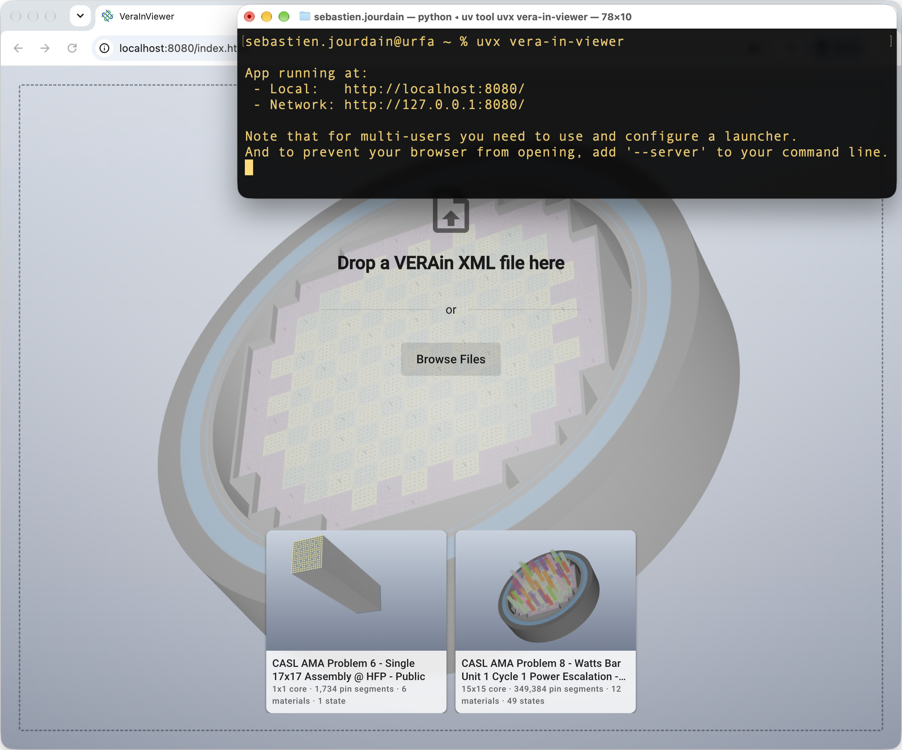

# VeraInViewer

A Python port of the **3D core visualization** of [VeraInView](https://casl.github.io/VeraInView/), built with
[trame](https://kitware.github.io/trame/), [VTK](https://vtk.org) and
[trame-vtklocal](https://github.com/Kitware/trame-vtklocal).



The scene is built with VTK on the server and mirrored in the browser with VTK.wasm, so all
rendering and interaction happen client side: only geometry and state changes go over the wire.

It reads VERAin XML files (Teuchos `ParameterList`, e.g. the built-in samples in `src/vera_in_viewer/samples`) and shows:

- every pin of every assembly / control / detector / insert, stacked along their axial
  elevations, as concentric material rings (one concentric cylinder mesh per cell type, split
  into one glyph mapper per material; walls only where a material is hidden)
- spacer grids (strap thickness computed from mass and density), baffle, vessel, neutron
  pads and core plates, each with its own visibility toggle
- per material visibility, using VeraInView's color palette and color assignment rules
- elevation slices (the rod segments crossing an axial range, with a wireframe outline)
- control rod banks: positions per `STATES` card (cumulative, like the simulation sees them),
  per bank slider and visibility, insert / withdraw all, color by bank
- 2D mode (parallel top view with pan/zoom interaction), vertical scaling, adjustable
  cylinder resolution

## Quick start

Requires [uv](https://docs.astral.sh/uv/).

```bash
uv run vera-in-viewer                          # pick a built-in sample or drop a file
uv run vera-in-viewer --data ~/cases           # also list the files of a directory
uv run vera-in-viewer --data ~/cases/core.xml  # loaded right away
```

A browser tab opens automatically. Useful trame options: `--port 1234`, `--server` (do not open a
browser), `--host 0.0.0.0`.

### Interaction

In 3D, left drag rotates, right drag (or scroll) zooms, shift + left drag (or middle drag)
pans. The toolbar holds the structure toggles and the vertical scale slider. A collapsible floating
bar at the top right of the 3D view holds the camera controls:

- reset camera: fit the scene without changing the view direction
- 2D/3D (pan / orbit icons): 2D switches to a parallel top view (like the 2D core maps of
  VeraInView) where left drag pans and right drag or scroll zooms (no rotation)
- perspective / parallel projection (cone / cylinder icons)
- top, side and isometric views
- download a PNG screenshot of the 3D view, read back from VTK.wasm in the browser. This needs a
  VTK nightly (9.7.20260716 or newer), the button is hidden with older versions:

  ```bash
  uv pip install --pre --index-url https://wheels.vtk.org "vtk>=9.7.20260716.dev0"
  uv run --no-sync vera-in-viewer
  ```

The bar collapses into a single button with its top chevron.

The start page is a full screen drop zone: drop or browse a local file, pick one of the built-in
samples (CASL AMA problems 6 and 8, with a preview of each) or one of the files given with `--data`.
Once loaded, the toolbar shows the case title, the file name with the core size, pin segment
and material counts, and a close button to go back to the start page.

## Development

```bash
uv sync --all-extras --dev  # create .venv with runtime + dev dependencies
uv run pytest               # run the tests
uvx nox                     # lint + tests on every supported Python
uvx nox -s fmt              # format and auto-fix with ruff
uvx nox -s serve            # launch the viewer
uvx nox -s build            # build sdist + wheel into ./dist
uvx pre-commit install      # optional: ruff + uv lock checks on commit

# Run pre-commit
uvx pre-commit run --all-files
```

| Tool        | Role                                                                    |
| ----------- | ----------------------------------------------------------------------- |
| uv          | Python/dependency management, locked in `uv.lock`, `uv_build` backend    |
| nox         | Task runner (`noxfile.py`), sessions use uv and the lock file            |
| ruff        | Linting and formatting (config in `pyproject.toml`)                      |
| pytest      | Tests, including the baffle/assembly overlap check on the built-in samples |
| pre-commit  | Optional git hooks (`.pre-commit-config.yaml`)                           |
| GitHub CI   | `.github/workflows/ci.yml` runs nox on Linux / macOS / Windows           |

### Layout

```
src/vera_in_viewer/
  parser.py     VERAin XML -> nested dicts (port of XMLVeraParser.js)
  colors.py     categorical color assignment (port of ColorManager.js + presets)
  model.py      dicts -> CoreModel: pin instances, grids, baffle, vessel, states
                (port of ImageGenerator.compute3DCore and ModelHelper extractors)
  geometry.py   VTK meshes: concentric cylinder source (port of vtk.js), cubes, glyph instances
  pipeline.py   CoreScene: VTK actors/mappers and view settings (port of PipelineManager.js)
  app.py        trame UI (vuetify 4) + trame-vtklocal LocalView
  module/serve/ client assets: 2D interaction script, start page style and background
  samples/      built-in VERAin samples, their previews and metadata (index.json)
tests/          unit tests and a tiny synthetic core (tests/data/mini_core.xml)
```

`model.py` is pure Python + numpy, so the reactor description can be reused or tested without VTK.

## Differences from VeraInView

- Only the 3D core view is ported (no 2D maps, cell/assembly views or editor).
- Assemblies are centered in their pitch (VeraInView offsets them by half a pin pitch).
- Baffle plates are computed per exposed assembly edge with proper convex/concave corner
  handling and Y orientation matching the core map, so they never overlap assemblies.
- Control rods start fully inserted.
- The LOD/Full switch is replaced by a resolution slider; the default depends on the number of
  pins (6 sides for full cores like VeraInView's LOD, 24 for small models).

## Implementation notes

- Cell connectivity is stored in fixed width (`int32`) arrays: `vtkIdTypeArray` is 64-bit on
  the server but 32-bit in the wasm32 client, which garbles the meshes.
- Coloring rods by bank uses a per instance color array toggled through the mapper scalar
  visibility: changing only the actor color of a `vtkGlyph3DMapper` was not always picked up by
  the client after a scene rebuild.
- VTK.wasm ignores interactor style changes after creation and has no serializer for
  `vtkInteractorStyleManipulator`, so the 2D mode keeps the trackball style and a small client
  script (`module/serve/view_2d.js`) remaps the left button to the middle one (pan).
- Scene updates are pushed one at a time and coalesced until the client acknowledges them,
  so quick successive changes are not lost behind a large update.
